<div align="center">



<br/>

[](#stack)
[](#stack)
[](#stack)
[](#stack)
[](#stack)

<br/>

| **4** | **7** | **0** | **65** |
| :---: | :---: | :---: | :---: |
| Followers | Repositories | Stars | Contributions |

[GitHub](https://github.com/work-aditya)

</div>

---

## Building in public

> **Focus:** JavaScript · TypeScript · PLpgSQL
>
> Designed to make the work, momentum, and next conversation easy to find.

---

## What I'm shipping

| Highlight | Focus | Snapshot |
| :--- | :--- | :--- |
| **JavaScript** | Core runtime & web apps | Public repositories |
| **work-aditya** | Active hub & profile work | Featured project |
| **Impact** | Steady shipping cadence | **0** stars · **65** contributions |

---

## Featured work

### `work-aditya`
A project built and shared in public.

`★ 0 stars` · `⑂ 0 forks` · [View project →](https://github.com/work-aditya)

### Selected work

| Project | Summary | Stack & Stars |
| :--- | :--- | :--- |
| **[work-aditya](https://github.com/work-aditya)** | A project built and shared in public. | Open source · ★ 0 |
| **[CulinaAI](https://github.com/work-aditya/CulinaAI)** | A project built and shared in public. | TypeScript · ★ 0 |
| **[otp-authentic-app](https://github.com/work-aditya/otp-authentic-app)** | A project built and shared in public. | JavaScript · ★ 0 |

---

## Signal

| Stars | Contributions | Repos | Followers |
| :---: | :---: | :---: | :---: |
| **0** | **65** | **7** | **4** |

---

## Stack

```text
JavaScript   ██████████████████████████████  (Primary)
TypeScript   ███████████
PLpgSQL      ████
CSS          ███
HTML         ██
